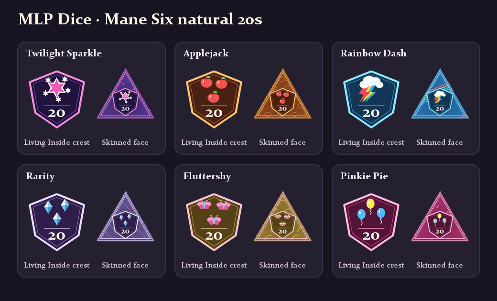

# MLP Dice

A Foundry VTT 14 module for *My Little Pony: Friendship Is Magic* and *Equestria Girls*. It includes 35 characters with two complete eight-die sets per character. Each set contains a d2, d4, d6, d8, d10, d12, d20, and d100 (percentile tens).

- **Skinned** uses self-contained 3D models with character-specific enamel, patterns, and numerals baked onto the faces.
- **Living Inside** suspends the character's cutie mark in glass with a themed animated effect. The effect follows Dicer's **Living insides** and **Inside motion** settings and the operating system's reduced-motion preference.
- **Natural 20** shows a numbered cutie-mark crest in both sets. Spike has a jewel-and-dragonfire crest.
- **Critical effects** give each character a different animation and synthesized sound for a natural 20 and natural 1. For example, Rainbow Dash gets a **Sonic Rainboom** or **Storm Cloud Stall**, and Pinkie Pie gets a **Party Cannon** or **Balloon Deflation**.

## Install in Foundry VTT

1. In Foundry VTT 14, open **Setup → Add-on Modules → Install Module**.
2. Paste this URL into **Manifest URL**, then click **Install**.

   ```text
   https://github.com/Nuku/mlp-dice/releases/latest/download/module.json
   ```

3. Install **Dicer** 1.3.7 or newer from **Install Module**. Open your world and enable **Dicer** and **MLP Dice** under **Game Settings → Manage Modules**.

For a manual install, extract the [release ZIP](https://github.com/Nuku/mlp-dice/releases/latest) into `Data/modules/mlp-dice` in your Foundry user data directory. Check that `Data/modules/mlp-dice/module.json` exists, then enable the modules in your world.

## Select dice

In Dicer, open **Configure Settings → Dicer → Browse dice themes → Module dice** and look for **MLP Dice**. Select a character and style, then use **Throw** to preview it or **Use as my default** to equip it. Enable **Picture and symbol faces** to see the Living Inside d20 crest.

Dice So Nice also receives the Skinned sets under **Dice Presets**. The animated glass uses Dicer's material API.

Critical effects play on eligible d20 rolls with either MLP Dice style in Dicer 1.3.7 or newer. They follow Dicer's **Special effects**, **Show other players' effects**, sound settings, and the operating system's reduced-motion preference. You can turn off the character effects on your client under **Configure Settings → MLP Dice → MLP Dice critical effects**.



## Roster

**Mane Six and Spike** — Twilight Sparkle, Applejack, Rainbow Dash, Rarity, Fluttershy, Pinkie Pie, Spike.

**Princesses and magic** — Princess Celestia, Princess Luna, Princess Cadance, Shining Armor, Starlight Glimmer, Sunset Shimmer, Trixie, Sunburst.

**Cutie Mark Crusaders and classmates** — Apple Bloom, Scootaloo, Sweetie Belle, Diamond Tiara, Silver Spoon.

**Ponyville and beyond** — Big McIntosh, Granny Smith, Cheerilee, Maud Pie, Zecora, DJ Pon-3, Octavia Melody, Derpy Hooves, Lyra Heartstrings, Sweetie Drops (Bon Bon), Dr. Hooves, Daring Do, Spitfire, Coco Pommel, Sugar Belle.

## Regenerate the artwork

In the source checkout, `tools/characters.json` holds each palette, texture pattern, movement, and art direction. The generator uses Python 3, Pillow, and a bold serif TrueType font. The shipped artwork uses Constantia Bold.

```powershell
python tools/generate_dice.py 'C:/Windows/Fonts/constanb.ttf'
```

The runtime files are `module.json`, `scripts/`, `styles/`, and `assets/`. The build tooling uses Ponyfinder's wrap geometry and face layout.

This is an unofficial fan module. My Little Pony and its characters belong to Hasbro. The module uses newly drawn interpretations of the marks. [Cutie Mark Crusaders reference](https://www.hasbro.com/common/documents/F0C7980050569047F5DE28496CA8092B/E22103F25000425D92E5FFEC7410C941.pdf) · [Cutie mark catalog](https://mlp.fandom.com/wiki/List_of_cutie_marks)
